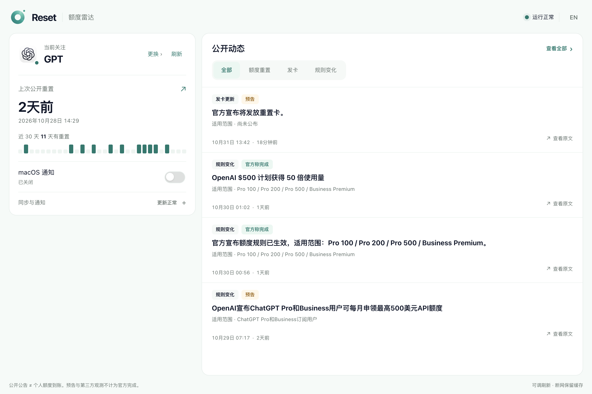
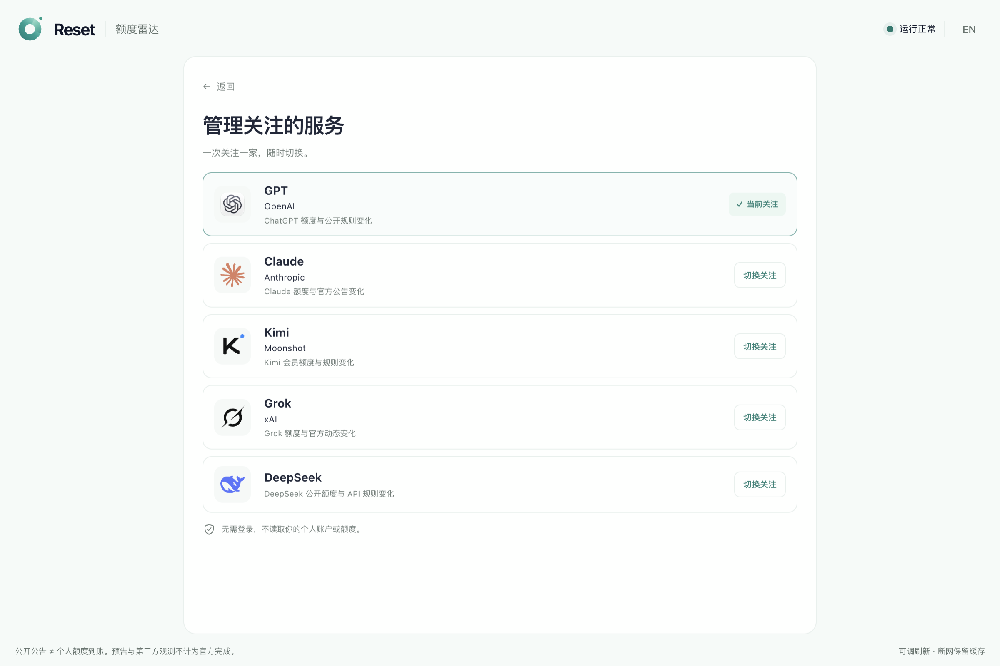

<p align="center"></p>

# Reset 雷达 · Reset Radar

在 Magpie 里，关注你正在使用的 AI 厂商。

GPT、Claude、Kimi、Grok、DeepSeek，五选一关注公开额度重置、发卡与规则变化。
无需注册，不读取个人账户，也不需要提供 API Key。

## 界面预览





## 安装

适用于 macOS 和 Magpie 0.1.2181 及以上版本。

打开 **Magpie → 插件 → 发现**，在 GitHub 社区插件列表搜索 **Reset**、
**Reset 雷达** 或 **Reset Radar**，选择 **Reset 雷达** 安装。
社区索引可能延迟；搜索不到时，在插件安装入口粘贴：

```text
github:YYKJ-AI/resetbell-magpie
```

也可使用一条安装命令：

```sh
magpie plugin add github:YYKJ-AI/resetbell-magpie
```

安装后，从侧栏打开 **Reset 雷达**，选择一家厂商即可。
不需要下载网站项目，也不需要自行配置服务。

## 使用

- **只关注一家**：随时切换 GPT、Claude、Kimi、Grok 或 DeepSeek；GPT 统一使用与网站相同的 ChatGPT 图标。
- **服务管理**：主页点击「更换」进入二级页面；管理页是唯一厂商选择入口，切换成功后自动回到主页。
- **合并卡片**：当前关注、上次公开重置和 macOS 通知集中在一张卡片；保留精确日期、近 30 天有重置的天数与逐日刻度，同步与通知详情按需展开。
- **一眼看完**：宽屏左侧监控、右侧动态，桌面尽量在一页内完成查看；手机自动改为单列。
- **分类动态**：按重置、发卡、规则变化筛选，显示最新 4 条；保留适用范围、公告状态与官方原文入口。
- **可选提醒**：默认关闭；开启后，只提醒此后发现的近期变化，不补发历史。通知提交成功不代表实收，macOS 权限或专注模式可能拦截显示。
- **统一品牌**：交互使用 Reset 官网青绿主题色，背景与文字适配 Magpie 明暗模式，保留彩色厂商图标。
- **可调刷新**：较快 2 分钟、标准 5 分钟（默认）、省电 15 分钟或仅手动；仅改变本机检查频率，不改变上游采集速度。失败时自动退避，服务端重试提示优先；仅手动不会自动检查或提醒。
- **离线可看**：连接中断时保留上次内容，并明确提示未更新。

Magpie 运行时持续关注，关闭插件页面不影响监控；退出 Magpie 或电脑休眠时，
首次安装的插件不能继续检查。重新打开后恢复。
macOS 是否显示提醒取决于系统通知权限和专注模式；
开启后可展开「同步与通知」，使用「测试提醒」检查。系统接受不等于已送达。

公开公告不证明个人额度到账。预告、第三方观察与官方完成状态会分别展示。

## 隐私

此客户端只读取 Reset 已公开的信息，不读取 Magpie 的账号、供应商密钥、
聊天记录或个人额度。选择和缓存保存在你自己的电脑上。
通知默认关闭，不自动更改系统权限。

## 网站与支持

- [Reset 网站](https://resetbell.dev)
- [报告问题](https://github.com/YYKJ-AI/resetbell-magpie/issues)

---

Follow public AI quota resets and official updates inside Magpie.
Install `github:YYKJ-AI/resetbell-magpie`, open **Reset Radar**, and choose
GPT, Claude, Kimi, Grok or DeepSeek. No login or personal API key required.
Manage five providers, view the latest four updates, filter by category and read original posts,
choose a 2/5/15-minute or manual refresh rate, and optionally enable notifications.
macOS / Magpie 0.1.2181+.
